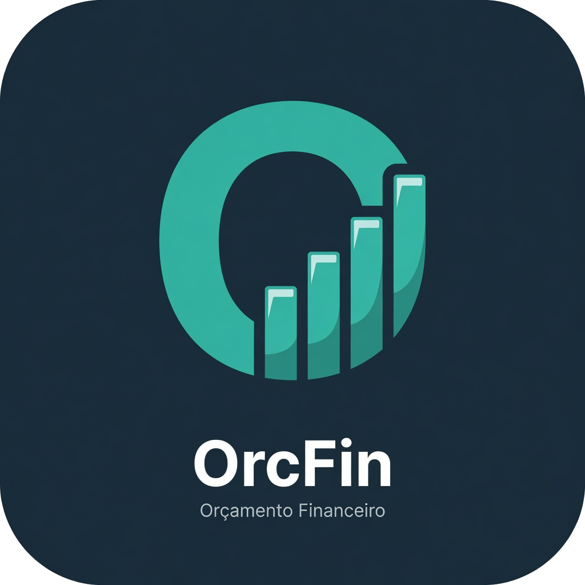

<div align="center">



# OrcFin

**Aplicación de escritorio de finanzas personales y gestión MEI 100% local.**  
Privada por diseño. Interfaz de escritorio moderna y fluida. Sin nube obligatoria, sin suscripciones y sin telemetría.

[](https://github.com/jorgeespinhara/OrcFin/releases/latest)
[](../frontend/)
[](../api/)
[](../LICENSE)

**[English](../README.md)** · **[Português (Brasil)](readme.pt-BR.md)** · **[Español](readme.es-ES.md)**

[Descargar para Windows (v1.0.0)](https://github.com/jorgeespinhara/OrcFin/releases/latest) · [Changelog](../CHANGELOG.md) · [Arquitectura de Privacidad](privacy.md)

</div>

---

## ¿Por qué OrcFin?

La mayoría de las apps financieras te obligan a subir todo tu historial bancario a una nube de pago o a mantener hojas de cálculo frágiles. **OrcFin** ofrece una experiencia de escritorio moderna manteniendo **el 100% de tus datos financieros en tu propio equipo**.

- **100% Local y Privado** — Base SQLite local (modo WAL), copias de seguridad `.orcfin.bak` cifradas (AES-GCM), secretos protegidos por el sistema, modo offline estricto y diagnóstico sanitizado sin telemetría.
- **Interfaz de Escritorio Moderna (PRO)** — Construida con **React 19, TypeScript, Tailwind CSS v4, Framer Motion y Recharts** ejecutándose en una ventana nativa **WebView2** (`pywebview`) sobre una API local FastAPI (`127.0.0.1`).
- **Pensado para la Rapidez** — Paleta de Comandos (`Ctrl+K`), nuevo movimiento global (`Ctrl+N`), búsqueda instantánea (`Ctrl+F`), filtros por categoría/tarjeta/orden, edición en lote y **Deshacer (5s)**.
- **Personal, Parejas y MEI (Brasil)** — Gestiona presupuestos individuales o consolidados junto a un módulo **MEI** dedicado (límite anual R$ 81.000, DAS mensual, clientes, facturas e importación de NF-e XML).
- **IA Opcional y Privada** — Conecta DeepSeek, Grok, Gemini, OpenAI o Claude. La IA **solo recibe totales mensuales agregados**, nunca descripciones individuales ni datos personales.

---

## Descargar e Instalar (Windows)

Ambos paquetes incluyen Python y la interfaz compilada — **no necesitas instalar Python ni Node.js**.

| Opción | Archivo | Tamaño | Ideal para |
| :--- | :--- | :---: | :--- |
| **Instalador (Recomendado)** | [`OrcFin-Setup.exe`](https://github.com/jorgeespinhara/OrcFin/releases/latest) | ~58 MB | Instalación por usuario (sin administrador), accesos directos y desinstalador limpio |
| **Portable (ZIP)** | [`OrcFin-portable.zip`](https://github.com/jorgeespinhara/OrcFin/releases/latest) | ~76 MB | Extraer en cualquier carpeta y ejecutar `OrcFin.exe` (sin borrar `_internal`) |

En el primer inicio, el **asistente de 3 pasos** permite elegir idioma/moneda (`BR`, `US`, `ES`), modo de uso y empezar **importando un extracto** (`OFX`/`CSV`/`PDF`), **explorando datos de ejemplo** o **restaurando una copia `.orcfin.bak`**.

---

## Ejecutar desde el código fuente

Requisitos: **Python 3.11+** y **Node.js 20+**.

```bash
git clone https://github.com/jorgeespinhara/OrcFin.git
cd OrcFin

# 1. Dependencias Python
python -m venv .venv
pip install -r requirements.txt

# 2. Compilar frontend React
cd frontend
npm ci
npm run build
cd ..

# 3. Iniciar la aplicación de escritorio
python main.py
```

### Tests y Empaquetado

```powershell
pytest -q
python scripts/package_portable.py
```

---

## Licencia

Licenciado bajo [GNU General Public License v3.0](../LICENSE).
